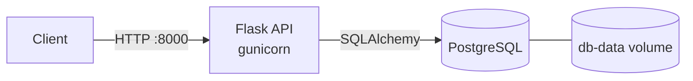
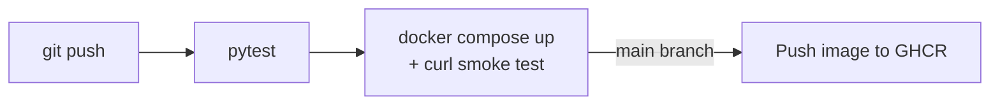

# Task API


A small REST API for managing tasks, built to practice containerization and CI/CD.
It runs as two containers (Flask API + PostgreSQL) with Docker Compose, and every
push is tested, smoke-tested in Docker and published to GitHub Container Registry
by GitHub Actions.

## Architecture





## Tech stack

- **App:** Python 3.12, Flask, SQLAlchemy, gunicorn
- **Database:** PostgreSQL 16 (SQLite in tests)
- **Containers:** Docker, Docker Compose (healthchecks, named volume, non-root user)
- **CI/CD:** GitHub Actions, GitHub Container Registry

## Run it

```bash
cp .env.example .env        # optional: change the database password
docker compose up -d --build
curl http://localhost:8000/health
```

Stop it with `docker compose down` (add `-v` to also delete the database volume).

## API

| Method | Path | Body | Description |
| --- | --- | --- | --- |
| GET | `/health` | | Checks the API and database are up |
| GET | `/tasks` | | List all tasks |
| POST | `/tasks` | `{"title": "..."}` | Create a task |
| GET | `/tasks/<id>` | | Get one task |
| PATCH | `/tasks/<id>` | `{"title": "...", "done": true}` | Update a task |
| DELETE | `/tasks/<id>` | | Delete a task |

```bash
curl -X POST -H "Content-Type: application/json" \
  -d '{"title":"Learn Docker"}' http://localhost:8000/tasks
```

## Run tests locally

```bash
python3 -m venv .venv && source .venv/bin/activate
pip install -r requirements-dev.txt
pytest -v
```
