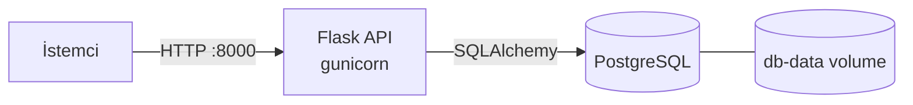
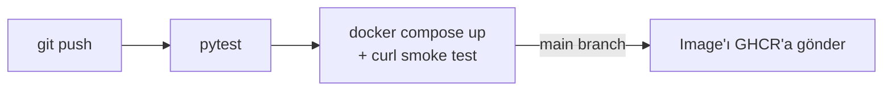

# Task API


Görev (task) yönetimi için küçük bir REST API. Container'laştırma ve CI/CD
pratiği yapmak için geliştirildi. Docker Compose ile iki container olarak
(Flask API + PostgreSQL) çalışır. Her push'ta GitHub Actions testleri çalıştırır,
Docker ortamını ayağa kaldırıp smoke test yapar ve image'ı GitHub Container
Registry'ye gönderir.

## Mimari





## Kullanılan teknolojiler

- **Uygulama:** Python 3.12, Flask, SQLAlchemy, gunicorn
- **Veritabanı:** PostgreSQL 16 (testlerde SQLite)
- **Container:** Docker, Docker Compose (healthcheck, named volume, root olmayan kullanıcı)
- **CI/CD:** GitHub Actions, GitHub Container Registry

## Çalıştırma

```bash
cp .env.example .env        # isteğe bağlı: veritabanı şifresini değiştir
docker compose up -d --build
curl http://localhost:8000/health
```

Durdurmak için `docker compose down` (veritabanını da silmek için `-v` ekle).

## API

| Metot | Yol | Body | Açıklama |
| --- | --- | --- | --- |
| GET | `/health` | | API ve veritabanının çalıştığını kontrol eder |
| GET | `/tasks` | | Tüm görevleri listeler |
| POST | `/tasks` | `{"title": "..."}` | Yeni görev oluşturur |
| GET | `/tasks/<id>` | | Tek bir görevi getirir |
| PATCH | `/tasks/<id>` | `{"title": "...", "done": true}` | Görevi günceller |
| DELETE | `/tasks/<id>` | | Görevi siler |

```bash
curl -X POST -H "Content-Type: application/json" \
  -d '{"title":"Docker öğren"}' http://localhost:8000/tasks
```

## Testleri lokalde çalıştırma

```bash
python3 -m venv .venv && source .venv/bin/activate
pip install -r requirements-dev.txt
pytest -v
```
